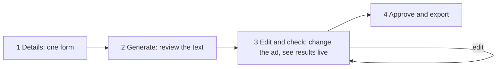

# User interface and home page

The four screens, the engaging home page plan and the design system.

## Design principles

1. **Plain words.** No technical terms in the interface. "Issue found" and "Cannot verify" always come with a sentence saying what and why.
2. **One thing per screen.** Four screens, each with one job.
3. **Show, do not tell.** The home page demonstrates the product, it does not only describe it.
4. **Never lose work.** Drafts save automatically. Every edit can be undone.
5. **Honest results.** Green, yellow and red each have an icon and a word, so color is never the only signal.
6. **Phone first.** Large touch targets, simple controls.
7. **Bangla and English** everywhere, switchable at any time.

## The four screens



| Screen | Job | Key interactions |
| --- | --- | --- |
| 1 Details | Collect everything once | Step-by-step cards. Example text beside "key features". Photo drop zone with instant quality warnings (too small, blurry, transparent). Brand colors picked from the logo automatically. Draft saved as you type. A "what is missing" panel in plain words |
| 2 Generate | Make the text and first ad | Animated progress ("Reading your details, writing text, checking facts, designing"). Edit any generated text. A clear label when basic text was used |
| 3 Edit and check | Change the ad and see it checked | Canvas on the left, check panel on the right. Drag, resize, edit text, change colors and fonts, switch template and size, replace photo. Undo and redo. Results update after each edit, with a short "checking" indicator |
| 4 Approve and export | Final decision | Summary of results, any overrides listed, one Approve button, export image and report |

## Home page plan (engaging)

```text
┌────────────────────────────────────────────────────────────────────┐
│  [Logo] AdBanao        How it works   Features   Pricing   [Sign in]│
├────────────────────────────────────────────────────────────────────┤
│  HERO                                                              │
│  "Your ad, written, designed and checked in minutes."              │
│  Sub-line: one form → image ad + description + accuracy check      │
│  [Try the sample]  [Start free]                  ┌───────────────┐ │
│                                                  │ LIVE DEMO     │ │
│  Type a product name and price: the ad on the    │ ad preview    │ │
│  right redraws as you type, with a green         │ updates as    │ │
│  "Price verified ✓" badge appearing.             │ you type      │ │
│                                                  └───────────────┘ │
├────────────────────────────────────────────────────────────────────┤
│  THE PROBLEM, IN 3 CARDS (animated on scroll)                      │
│  Wrong prices · Invented claims · Unchecked edits                  │
├────────────────────────────────────────────────────────────────────┤
│  HOW IT WORKS: 4 steps with small looping animations               │
│  1 Fill the form → 2 Get ad + text → 3 Edit freely → 4 Approve     │
├────────────────────────────────────────────────────────────────────┤
│  BEFORE / AFTER SLIDER                                             │
│  Drag to compare an ad with a wrong price (red flag) and the fixed │
│  one (green check). Shows the checker in action.                   │
├────────────────────────────────────────────────────────────────────┤
│  FEATURE GRID: description writer · editor · price checker ·       │
│  claim checker · brand guard · Bangla support                      │
├────────────────────────────────────────────────────────────────────┤
│  HONEST PROMISE section                                            │
│  "We say 'Cannot verify' instead of guessing. Your photo is never  │
│  changed. A human always approves."                                │
├────────────────────────────────────────────────────────────────────┤
│  FAQ · Final call to action [Start free] · Footer                  │
└────────────────────────────────────────────────────────────────────┘
```

Engagement techniques (each one serves the product, none is decoration only):

| Technique | Purpose | Tool |
| --- | --- | --- |
| Live demo in the hero: edit text and see the ad and a check badge update | Proves the idea in 10 seconds without sign-up | React state plus a small client-side sample renderer (not the real server render, and labelled "sample") |
| Before and after slider with a wrong-price ad | Shows the main value: catching errors | Framer Motion drag |
| Scroll-triggered reveals, kept subtle | Guides the eye through the story | Framer Motion `whileInView` |
| Animated check badges (red flag becomes green tick) | Makes verification feel real | SVG plus Framer Motion |
| Respect "reduce motion" settings | Accessibility | CSS media query and Framer Motion setting |
| Language switch in the header | Bangla audience | react-i18next |
| Sample gallery of generated ads | Social proof without invented testimonials | Real outputs from our own test set |

Rules for the home page:

- **No fake testimonials, logos or numbers.** Everything shown is real or clearly labelled as a sample.
- Performance budget: largest content paint under 2.5 seconds on a mid-range phone, images optimised, fonts subsetted.
- Pre-rendered at build time so search engines can read it.
- Accessible: keyboard navigable, AA contrast, alt text, animations can be turned off.

## Design system

| Item | Decision |
| --- | --- |
| Components | shadcn/ui on Radix, so keyboard and screen-reader behaviour comes built in |
| Tokens | Colors, spacing, radius and type scale defined once as CSS variables and Tailwind theme. Light and dark themes |
| Result colors | Verified: green. Issue found: red. Cannot verify: amber. Each with its own icon and label |
| Type | A clean sans for English plus Noto Sans Bengali for Bangla |
| Feedback | Skeleton loaders, toasts for success and errors, inline field errors in plain words |
| Empty states | Every empty list says what to do next |
