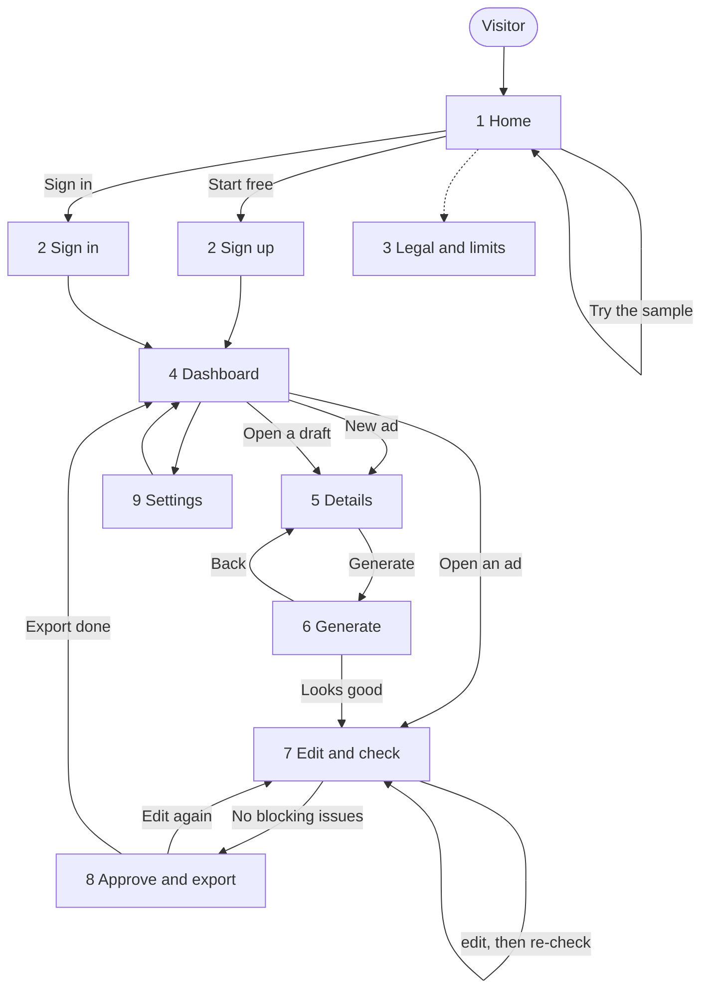

# Pages, functions and user flow

Every page of AdBanao: what it looks like, what it does, and how a user moves between pages.

This file extends [08-ui-and-home-page.md](08-ui-and-home-page.md), which defines the four core screens and the home page. Here the whole product is mapped, including the pages 08 implies but does not list. Goal IDs refer to [07-roadmap.md](07-roadmap.md).

**Sample sketches** of every page are in [section 7](#7-sample-views).

**Source of each item.** Pages 1, 4 to 8 come straight from the existing plan. Pages 2, 3 and 9 are implied by it (accounts, legal notices, brand editing). The route names and the dashboard layout are proposals for the owner to approve.

---

## 1. Page map

| # | Page | Route (proposed) | Who can open it | Roadmap goal |
| --- | --- | --- | --- | --- |
| 1 | Home | `/` | Everyone | U1, U2 |
| 2 | Sign up / Sign in | `/sign-in`, `/sign-up` | Signed-out visitors | U3, F9 |
| 3 | Privacy, terms and limitations | `/legal` | Everyone | S4, S5 |
| 4 | Dashboard | `/app` | Signed-in users | U3 |
| 5 | Screen 1: Details | `/app/new`, `/app/products/:id/details` | Signed-in users | U4 |
| 6 | Screen 2: Generate | `/app/products/:id/generate` | Signed-in users | U5 |
| 7 | Screen 3: Edit and check | `/app/ads/:id/edit` | Signed-in users | U6, U7 |
| 8 | Screen 4: Approve and export | `/app/ads/:id/approve` | Signed-in users | U8 |
| 9 | Brands and account settings | `/app/settings` | Signed-in users | U3, U9 |

**Minimum version: 7 pages.** Home, Sign in, Dashboard and the four screens. Fold page 3 into the home page footer and page 9 into the dashboard.

---

## 2. How the user moves through the product



**The core loop is Screen 3.** Every edit creates a new version and a new check. An edit also cancels any earlier approval (rule FR-13).

**Ad status shown on each page** (from [04-architecture.md](04-architecture.md)):

| Status | Meaning | Where the user can be |
| --- | --- | --- |
| `draft` | New, or edited since the last check | Dashboard, Screens 1 to 3 |
| `needs_fix` | Checks found issues | Screen 3 |
| `verified` | All checks passed, not yet approved | Screens 3 and 4 |
| `approved` | A human approved this exact content hash | Screen 4. Export is allowed only here |

---

## 3. Rules that apply to every page

| Rule | What it means in practice |
| --- | --- |
| Plain words | No technical terms. "Issue found" and "Cannot verify" always come with a sentence saying what and why |
| One job per screen | Each screen has one main button |
| Never lose work | Drafts save as the user types. Every edit can be undone |
| Color is never alone | Green, red and amber each have an icon and a word (rule NFR-09) |
| Phone first | Touch targets at least 44 px, one column on small screens, tested at 360 px wide |
| Bangla and English | A language switch in the header on every page, remembered between visits |
| Light and dark | Both themes. Colors come from tokens, never hard-coded |
| Reduced motion | All animation turns off when the system asks for it |
| Honest wording | "No issues detected", never "guaranteed" or "100% accurate" |
| Loading and empty states | Skeleton loaders while waiting. Every empty list says what to do next |
| Errors | Plain sentence, what happened and what to try. Never a raw error code on screen |
| Ownership | Every signed-in page shows only the user's own data. Another user's ID returns "not found" |

**Result colors (one set, used on every page):**

| Result | Color | Icon | Word |
| --- | --- | --- | --- |
| Verified | Green | Check in a circle | "Verified" |
| Issue found | Red | Flag | "Issue found" |
| Cannot verify | Amber | Question mark | "Cannot verify" |

**Visual style** follows the current home page: cream background, deep green brand color, Source Serif 4 for headings, Inter for interface text, Noto Sans Bengali for Bangla, shadcn/ui components.

---

## 4. Page by page

### Page 1: Home

**Purpose.** Convince a visitor in about 10 seconds, let them try it without an account, and send them to sign up.

**Layout, top to bottom.**
1. Header: logo, links (How it works, Features, Examples, FAQ), language switch, theme switch, Sign in, Get Started. On a phone the links collapse into a menu.
2. Hero: headline and short promise on the left, the tilted app window with the live demo on the right.
3. Features: four overlapping cards.
4. How it works: four steps with arrows.
5. Examples: four photo cards (fashion, food, beauty, electronics).
6. Banner: "Helpful checks. Honest results."
7. FAQ: four to six questions.
8. Closing call to action, then footer with links to the legal page.

**Functions.**
- Live demo: edit name, price, feature and ad price, and the ad redraws. Click "Check Ad" and the result appears.
- Clicking an example card loads that sample into the demo.
- Language and theme switches.
- "Start free" and "Get Started" go to Sign up. "Sign in" goes to Sign in.

**Must be true.**
- The check result, the one-click fix and the Approve step are visible in the demo. Today they are hidden by CSS and need to be shown, or the page promises things it does not show.
- The demo is labelled "sample" and says nothing is saved.
- No fake testimonials, logos or numbers.
- Features that the page names (for example "Download or share") must exist, or the wording changes to match what the product really does.
- Largest content paint under 2.5 s on a mid-range phone. Hero photo optimised and not blocking first render. Page pre-rendered at build time.
- A signed-in visitor sees "Dashboard" in the header instead of Sign in and Get Started.

**Leads to.** Sign up, Sign in, Legal.

---

### Page 2: Sign up / Sign in

**Purpose.** Create an account or return to one, then land where the user left off.

**Layout.** One centered card on the cream background. A short line about what the user gets, the form, and a switch link between Sign up and Sign in. The language switch stays in the corner. On a phone the card fills the width.

**Functions.**
- Sign up with email and password, or a provider login if the auth provider supports it.
- Sign in, sign out, and password reset by email.
- Sign out lives in the app header, not on this page.
- After sign-in, go to the saved draft if one exists, otherwise to the Dashboard.
- A link back to the home page sample for people who are not ready.

**States and errors.**
- Wrong password, unknown email, weak password, and network failure each get a plain sentence.
- Fields keep what the user typed after an error.
- Rate limits show a "try again in a minute" message.

**Rules.**
- No hand-written password storage. Use the provider (open decision 2 in [15-risks.md](15-risks.md)).
- Tokens are short-lived. Pages under `/app` redirect here when signed out and return the user to the page they wanted.

**Leads to.** Dashboard.

---

### Page 3: Privacy, terms and limitations

**Purpose.** Say plainly what the tool does, what it cannot do, and what happens to the user's data.

**Layout.** One long, readable page with three anchored sections and a short table of contents at the top. Reading width about 40 rem.

**Content.**
- **Privacy:** free AI providers may use submitted data, so do not upload confidential material. Data export and account deletion are planned before public launch.
- **Terms:** the user confirms they own the images and logos they upload. Restricted products (alcohol, tobacco, medicine) get a warning. The tool flags issues and is not legal advice.
- **Known limitations:** the list from [14-limitations-and-evaluation.md](14-limitations-and-evaluation.md), written for non-technical readers. It includes that the check cannot guarantee correctness, human approval is always needed, Bangla is weaker than English, and the browser preview may differ slightly from the exported image.

**Where else this appears.** A short version of the data notice shows next to the photo upload on Screen 1 and next to the Generate button on Screen 2. The full page is linked from the footer of every page.

---

### Page 4: Dashboard

**Purpose.** The user's home inside the app: see everything, start something new, or pick up where they left off.

**Layout.**
- Top bar: logo, language and theme switches, account menu (Settings, Sign out).
- Main area with three tabs: **Ads**, **Products**, **Brands**.
- A prominent "New ad" button, always visible, bottom-right on a phone.
- Ads shown as cards: thumbnail of the latest render, product name, status chip (Draft, Needs fix, Verified, Approved), last edited time.

**Functions.**
- Create a new ad (goes to Screen 1).
- Open a draft (goes to Screen 1 or 2, wherever the user stopped) or an existing ad (goes to Screen 3, or Screen 4 if approved).
- Search and filter by status and brand. Pagination uses `limit` and `cursor`.
- Archive and restore products and brands. Nothing is deleted (ADR 0006).
- Duplicate an ad as a starting point (optional, later).

**States.**
- Empty: a friendly one-line explanation and a single "Create your first ad" button.
- An approved ad that was edited shows as Draft, never as Approved.
- Archived items are hidden by default with a "Show archived" switch.

**Leads to.** Screen 1, Screen 3, Screen 4, Settings.

---

### Page 5: Screen 1, Details

**Purpose.** Collect everything once. Everything later is built from these facts.

**Layout.**
- A step-by-step form made of cards: **Brand**, **Product basics**, **Key features**, **Photo**, **Ad settings**.
- On desktop, a "What is missing" panel on the right. On a phone it becomes a collapsible bar at the top.
- A progress indicator across the four screens (1 of 4).

**Fields.**

| Card | Fields |
| --- | --- |
| Brand | Pick a brand or create one: name, colors, fonts, logo, tone |
| Product basics | Name, price, original price (optional), currency, unit |
| Key features | A list of short features, with an example shown beside the field |
| Photo | Drag-and-drop zone with instant warnings (too small, blurry, transparent) |
| Ad settings | Language (English or Bangla), ad size (square post, story, banner), template |

**Functions.**
- Price and unit are cleaned automatically ("৳1,299", "1299.00", "BDT 1299", Bangla digits). Ambiguous input is rejected with a clear message (FR-04).
- Brand colors are suggested from the logo.
- Drafts save automatically as the user types.
- The "What is missing" panel lists, in plain words, what must be added before generating (FR-05).
- A checkbox confirms the user owns the photo and logo. A warning appears for restricted products.
- The **Generate** button stays disabled until required data is present, and says why.

**Rules.**
- The uploaded photo is stored byte for byte and never altered. Its hash is shown as "Original photo saved" (NFR-02).
- Uploads are checked by content, not file name.

**Leads to.** Screen 2 on Generate. Back to Dashboard saves the draft.

---

### Page 6: Screen 2, Generate

**Purpose.** Write the text and build the first ad, and let the user review the words before designing.

**Layout.**
- While working: a centered progress view with four labelled stages, "Reading your details", "Writing text", "Checking facts", "Designing".
- When done: the generated text in editable fields (description, headline, tagline, button text) next to a small preview of the first ad.

**Functions.**
- Edit any generated text. Hand edits are never overwritten.
- **Regenerate** produces new text and keeps the earlier versions.
- A clear label, "Basic text", appears when the AI service was unavailable or rate limited and the fallback was used (FR-07, NFR-04).
- If a generated line was rejected for inventing a price, number or claim, a short note says so.
- **Continue to editor** builds the ad and opens Screen 3.

**States.**
- Progress never freezes. A timeout shows a plain message with Retry and "Use basic text".
- Language is respected. Bangla output is labelled as possibly weaker, with the reason.

**Leads to.** Screen 3. Back to Screen 1 keeps all entered data.

---

### Page 7: Screen 3, Edit and check

**Purpose.** Change the ad and see it checked, as often as needed. This is the main working screen.

**Layout.**
- **Desktop:** the canvas on the left (about two thirds), the check panel on the right. A toolbar above the canvas. A layer panel as a collapsible list.
- **Phone:** the canvas on top, the check panel as a bottom sheet the user pulls up. Large touch controls.

**Toolbar and canvas functions.**
- Move, resize and rotate layers. Edit text, colors and fonts (only fonts that support Bangla are offered).
- Show or hide layers. Switch template or size. Replace the photo.
- Undo and redo. Every edit creates a version.
- The photo layer has its ratio locked, and the user is warned if cropping would cut off the product.

**Check panel.**
- One card per check: price and details, text (OCR), claims, brand, photo integrity.
- Each card shows the result with icon and word, the reason, the severity (critical, warning, suggestion) and the evidence (expected value and found value).
- Cards are ordered by severity, worst first.
- **One-click fix** where one exists. A fix is re-checked immediately.
- **Override with a written reason** for a result the user disagrees with. Overrides are recorded (FR-17).
- A short "Checking…" indicator after each edit. Results never show "Verified" without evidence (NFR-01).

**Must be true.**
- A final server render is shown before approval, because the browser preview can differ slightly from the exported image (risk R-05).
- Any edit after approval cancels the approval and shows a plain note.
- If the same ad is open in two tabs, the user is warned that the last save wins.
- Very long edit sessions keep the history but compress older versions.

**Leads to.** Screen 4 when the user clicks "Review and approve". The button is enabled once the latest version has no critical issues, or each is overridden with a reason.

---

### Page 8: Screen 4, Approve and export

**Purpose.** The final decision, made by a person.

**Layout.** A single column. At the top, a preview of the final server render. Below it, the result summary. At the bottom, the actions.

**Content and functions.**
- A summary of the latest check results for this exact version.
- Any overrides listed with their written reasons and who made them.
- One **Approve** button. Approval stores the content hash of this version (ADR 0004).
- After approval: **Export image** (in the chosen size) and **Download report**. Approve and export are safe to repeat.
- **Edit again** returns to Screen 3 and warns that the approval will be cancelled.
- Optional: **Copy ad text** for people who post it themselves.

**Rules.**
- Only a verified, approved, unmodified version can be exported (FR-15).
- If the content hash no longer matches, the page shows "This ad changed after approval. Check it again." and offers a way back.
- Undoing back to identical content makes the earlier approval valid again, and the page says so.
- Wording is "no issues detected", never "guaranteed compliant".

**Leads to.** Dashboard after export. Screen 3 for more edits.

---

### Page 10: Admin sign in and admin console (built)

`admin-login.html` asks for admin email, password and secret word. The console is only for users with the `admin` role who signed in there. Shows users, activity and controls (suspend, make admin, sign out everywhere, CSV). Full description: [22-admin.md](22-admin.md). Signed-out visitors go to sign in; normal users see "Admins only".

### Page 9: Brands and account settings

**Purpose.** Manage the things that outlive a single ad.

**Layout.** Two tabs on one page.

| Tab | Functions |
| --- | --- |
| **Brands** | List, edit and archive or restore brands. Edit colors, fonts, logo (several versions: light, dark, icon-only) and tone notes. Agencies see each brand's data kept separate |
| **Account** | Email, password change, default language, sign out. Later: export my data and delete my account (planned before public launch, see [11-security-and-legal.md](11-security-and-legal.md)) |

**Rules.**
- Archiving a brand never breaks ads that use it. Archived brands stay readable.
- A brand change affects new ads. Existing ads keep their version history.

---

## 5. Build order and roadmap fit

| Roadmap goal | Pages it delivers |
| --- | --- |
| U1 Frontend scaffold | App shell, routing, theme and language switch, generated API client |
| U2 Engaging home page | Page 1 |
| U3 Sign-in screens and app shell | Pages 2, 4 and the basic part of 9 |
| U4 Screen 1 | Page 5 |
| U5 Screen 2 | Page 6 |
| U6 Screen 3 (editor) and U7 check panel | Page 7 |
| U8 Screen 4 | Page 8 |
| U9 Polish | Accessibility, phone layouts, Bangla review, and the rest of page 9 |
| U10 End-to-end tests | The whole flow in Playwright |
| S4, S5 | Page 3, as the final privacy and legal wording |

Pages 3 and 9 are not separate goals in the current roadmap. Adding them as goals, or folding them into U3, U9 and S5 as above, is the owner's decision.

---

## 6. Open decisions

| # | Question | Recommendation |
| --- | --- | --- |
| 1 | One route per wizard screen, or one route with four steps | One route per screen, so the browser Back button and bookmarks work |
| 2 | Is the legal page separate or part of the home page footer | A separate page, linked from every footer, because it is also linked from the upload and generate screens |
| 3 | Auth provider (affects page 2 and the account tab of page 9) | See decision 2 in [15-risks.md](15-risks.md) |
| 4 | Show the Dashboard as the landing page for signed-in users at `/` | Yes, redirect `/` to `/app` when signed in, but keep the header link back to the home page |

---

## 7. Sample views

Minimal sketches of each page. They show where things sit, not the final design. The real look follows the style in section 3.

**Symbols used**

```text
▢  image or photo       [ ]  button           [____]  text field
☐  checkbox   ☑  checked   ▾  dropdown          ■  color swatch
✓  verified   ✗  issue found   ?  cannot verify   !  warning
○  not started   ●  current step   ◌  in progress   ← →  go back / forward
```

### Page 1: Home

The hero demo shows the check result. Sections run top to bottom.

```text
┌──────────────────────────────────────────────────────────────────────────────┐
│ ◼ AdBanao     How · Features · Examples · FAQ       EN|BN ◐ Sign in [Start]  │
│ ──────────────────────────────────────────────────────────────────────────── │
│ Ads that are checked  ┌─ Form ──────────────────┐  ┌─ Ad ────────────┐       │
│ before you publish.   │ Name  [Classic Panjabi] │  │   ▢ photo       │       │
│                       │ Price [1299]            │  │ Classic Panjabi │       │
│ [Make your ad now]    │ [ Check Ad ]            │  │ [ 1,299 ]       │       │
│ [See how it works]    └─────────────────────────┘  │ ✓ Price matches │       │
│                                                    └─────────────────┘       │
│ ──────────────────────────────────────────────────────────────────────────── │
│ ◇ Verify ads    ◇ Edit with ease    ◇ Export    ◇ Bangla + English           │
│ ──────────────────────────────────────────────────────────────────────────── │
│ (1) Add product → (2) Create ad → (3) Check → (4) Approve                    │
│ ──────────────────────────────────────────────────────────────────────────── │
│ [▢ Fashion]   [▢ Food]   [▢ Beauty]   [▢ Tech]                               │
│ ──────────────────────────────────────────────────────────────────────────── │
│ ▓ Helpful checks. Honest results.                    [Learn more] ▓          │
│ ──────────────────────────────────────────────────────────────────────────── │
│ ▸ Does AdBanao publish my ad?                                                │
│ ▸ What does the check cover?                                                 │
│ ──────────────────────────────────────────────────────────────────────────── │
│ Make your next ad with confidence.          [Try AdBanao free]               │
│ Privacy · Terms · Limits                                                     │
└──────────────────────────────────────────────────────────────────────────────┘
```

### Page 2: Sign up / Sign in

One card. The same layout switches between Sign in and Sign up.

```text
┌──────────────────────────────────────────────────────────────────────────────┐
│ ◼ AdBanao                                                    EN|BN  ◐        │
│                                                                              │
│       ┌─────────────────────────────────┐                                    │
│       │ Welcome back                    │                                    │
│       │                                 │                                    │
│       │ Email    [____________________] │                                    │
│       │ Password [____________________] │                                    │
│       │                                 │                                    │
│       │ [          Sign in          ]   │                                    │
│       │ Forgot password?                │                                    │
│       │ New here? Create an account     │                                    │
│       └─────────────────────────────────┘                                    │
│                                                                              │
│       ← Try the sample first                                                 │
└──────────────────────────────────────────────────────────────────────────────┘
```

### Page 3: Privacy, terms and limitations

One readable page with three anchored sections.

```text
┌──────────────────────────────────────────────────────────────────────────────┐
│ ◼ AdBanao                                                    EN|BN  ◐        │
│ ──────────────────────────────────────────────────────────────────────────── │
│ Contents:  Privacy · Terms · Limitations                                     │
│                                                                              │
│ ── Privacy ──                                                                │
│ Free AI providers may use what you submit. Do not upload                     │
│ confidential material.                                                       │
│                                                                              │
│ ── Terms ──                                                                  │
│ • You confirm you own the photos and logos you upload.                       │
│ • Alcohol, tobacco and medicine ads get a warning.                           │
│                                                                              │
│ ── Limitations ──                                                            │
│ • "No issues detected" is not a guarantee.                                   │
│ • A person always approves.  • Bangla is weaker than English.                │
│ ──────────────────────────────────────────────────────────────────────────── │
│ Privacy · Terms · Limits                                                     │
└──────────────────────────────────────────────────────────────────────────────┘
```

### Page 4: Dashboard

Ads as cards with a status chip. One always-visible "New ad" button.

```text
┌──────────────────────────────────────────────────────────────────────────────┐
│ ◼ AdBanao                                          EN|BN  ◐  [Account ▾]     │
│ ──────────────────────────────────────────────────────────────────────────── │
│ [Ads]  Products  Brands          (search ______)   [Status ▾]                │
│                                                                              │
│ ┌─────────────────┐  ┌─────────────────┐  ┌─────────────────┐                │
│ │    ▢            │  │    ▢            │  │    ▢            │                │
│ │ Classic Panjabi │  │ Berry Cake      │  │ Rose Lotion     │                │
│ │ ✓ Approved      │  │ ✗ Needs fix     │  │ ○ Draft         │                │
│ └─────────────────┘  └─────────────────┘  └─────────────────┘                │
│                                                                              │
│                                                      [+ New ad]              │
└──────────────────────────────────────────────────────────────────────────────┘
```

### Page 5: Screen 1, Details

One form. The "Missing" list says why Generate is disabled.

```text
┌──────────────────────────────────────────────────────────────────────────────┐
│ ◼ AdBanao     Step 1 of 4  ●○○○              ✓ Draft saved                   │
│ ──────────────────────────────────────────────────────────────────────────── │
│ ┌─ Details ─────────────────────────────────────────┐  ┌─ Missing ───┐       │
│ │ Brand   [Rahim Fashion ▾]   colors ■■■  logo ▢    │  │ ✗ Photo     │       │
│ │                                                   │  │ ✗ Features  │       │
│ │ Name    [____________]                            │  │ ✓ Name      │       │
│ │ Price   [______]  Unit [____]                     │  │ ✓ Price     │       │
│ │                                                   │  └─────────────┘       │
│ │ Features  • [____________]  e.g. "Premium cotton" │                        │
│ │           • [____________]                        │                        │
│ │                                                   │                        │
│ │ Photo   ┌ drop photo here ┐   ⚠ too small?        │                        │
│ │         └─────────────────┘                       │                        │
│ │                                                   │                        │
│ │ Language (EN|BN)    Size [Square ▾]               │                        │
│ └───────────────────────────────────────────────────┘                        │
│                                                                              │
│ ☐ I own this photo                [← Back]   [Generate →]                    │
└──────────────────────────────────────────────────────────────────────────────┘
```

### Page 6: Screen 2, Generate

First the progress view, then the text to review and edit.

```text
┌──────────────────────────────────────────────────────────────────────────────┐
│ ◼ AdBanao     Step 2 of 4  ○●○○                                              │
│ ──────────────────────────────────────────────────────────────────────────── │
│ ┌─ While working ────────┐                                                   │
│ │ ✓ Reading your details │                                                   │
│ │ ✓ Writing text         │                                                   │
│ │ ◌ Checking facts       │                                                   │
│ │ ○ Designing            │                                                   │
│ └────────────────────────┘                                                   │
│                                                                              │
│ ┌─ Review ──────────────────────────────────────────┐  ┌─ Preview ───┐       │
│ │ Headline    [______________]                      │  │   ▢ ad      │       │
│ │ Tagline     [______________]                      │  │   preview   │       │
│ │ Button      [______________]                      │  └─────────────┘       │
│ │ Description [______________]                      │                        │
│ │                                                   │                        │
│ │ ⚠ Basic text used (AI unavailable)   [Regenerate] │                        │
│ └───────────────────────────────────────────────────┘                        │
│                                                                              │
│ [← Back]                                   [Continue to editor →]            │
└──────────────────────────────────────────────────────────────────────────────┘
```

### Page 7: Screen 3, Edit and check (desktop)

Canvas on the left, check panel on the right.

```text
┌──────────────────────────────────────────────────────────────────────────────┐
│ ◼ AdBanao    Step 3 of 4  ○○●○   [↶][↷]  Size [▾]  Template [▾]  [Review →]  │
│ ──────────────────────────────────────────────────────────────────────────── │
│ ┌─ Layers ───┐ ┌─ Canvas ──────────────────┐ ┌─ Checks ────────────────┐     │
│ │ ☑ Photo    │ │ Classic Panjabi    ▢ logo │ │ ✗ Price 999 ≠ 1,299     │     │
│ │ ☑ Title    │ │                           │ │   [Use 1,299]           │     │
│ │ ☑ Price    │ │   ┌─────────────┐         │ │ ! Claim "best"          │     │
│ │ ☑ Button   │ │   │    photo    │         │ │   [Remove]              │     │
│ │ ☑ Logo     │ │   └─────────────┘         │ │ ✓ Text   ✓ Brand        │     │
│ └────────────┘ │                           │ │ ✓ Photo                 │     │
│                │ [ 999 ]    [ Shop now ]   │ │ ? Claims: cannot verify │     │
│                └───────────────────────────┘ └─────────────────────────┘     │
└──────────────────────────────────────────────────────────────────────────────┘
```

### Page 7: Screen 3, Edit and check (phone)

The canvas on top, the checks as a bottom sheet the user pulls up.

```text
┌─ Canvas ────────────┐
│ Classic Panjabi     │
│ ┌─────────────┐     │
│ │    photo    │     │
│ └─────────────┘     │
│ [ 999 ]  [Shop now] │
└─────────────────────┘
┌─ Checks (pull up) ─────────┐
│ ▔▔ 2 things to fix ▲       │
│ ✗ Price 999 ≠ 1,299  [Fix] │
└────────────────────────────┘
```

### Page 8: Screen 4, Approve and export

One Approve button. Export is enabled only after approval.

```text
┌──────────────────────────────────────────────────────────────────────────────┐
│ ◼ AdBanao     Step 4 of 4  ○○○●                                              │
│ ──────────────────────────────────────────────────────────────────────────── │
│ ┌─ Final render ───┐  ┌─ Result for this version ────────────┐               │
│ │                  │  │ ✓ Price   ✓ Text   ✓ Brand   ✓ Photo │               │
│ │    ▢ final       │  │ ! Override: claim "best"             │               │
│ │    render        │  │   reason: "Owner approved"           │               │
│ │                  │  └──────────────────────────────────────┘               │
│ └──────────────────┘                                                         │
│                                                                              │
│ [← Edit again]                                   [ Approve ✓ ]               │
│                                                                              │
│ After approval:  [Export image ⇩]  [Download report ⇩]  [Copy text]          │
│                                                                              │
│ ✗ If the ad changed after approval:  "Check it again."                       │
└──────────────────────────────────────────────────────────────────────────────┘
```

### Page 9: Brands and account settings

Two tabs: Brands and Account.

```text
┌──────────────────────────────────────────────────────────────────────────────┐
│ ◼ AdBanao                                          EN|BN  ◐  [Account ▾]     │
│ ──────────────────────────────────────────────────────────────────────────── │
│ [Brands]  Account                                                            │
│                                                                              │
│ ┌─ Brands ─────────────────────────┐  ┌─ Edit brand ───────────────────┐     │
│ │ ■ Rahim Fashion  [Edit][Archive] │  │ Name [_______]  Tone [_______] │     │
│ │ ■ Sweet Corner   [Edit][Archive] │  │ Colors ■ ■ ■   Fonts [▾]       │     │
│ │                                  │  │ Logos  ▢ light ▢ dark ▢ icon   │     │
│ │ [+ New brand]                    │  └────────────────────────────────┘     │
│ └──────────────────────────────────┘                                         │
│                                                                              │
│ ┌─ Account tab ────────────────────────┐                                     │
│ │ Email [__________]   Language [EN ▾] │                                     │
│ │ [Change password]   [Sign out]       │                                     │
│ └──────────────────────────────────────┘                                     │
└──────────────────────────────────────────────────────────────────────────────┘
```
